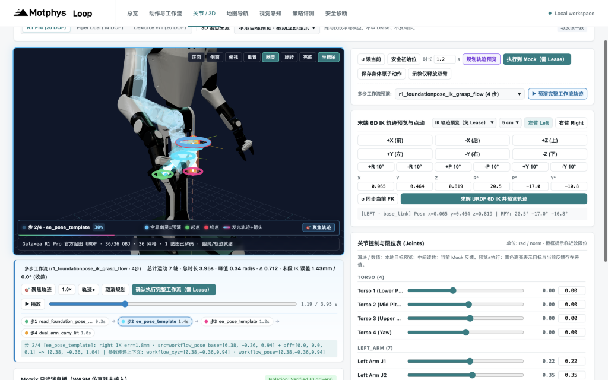
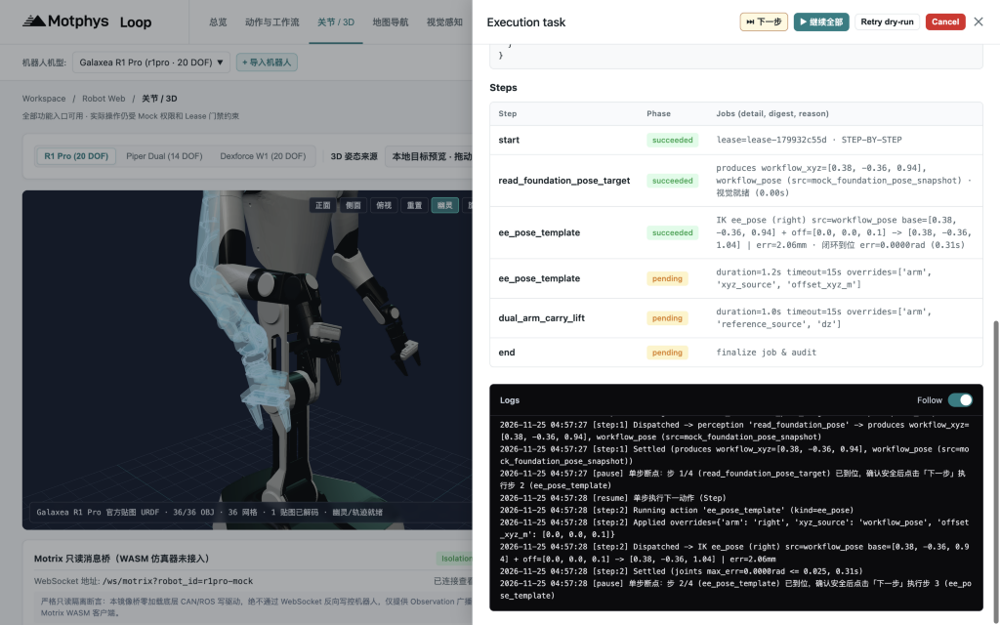
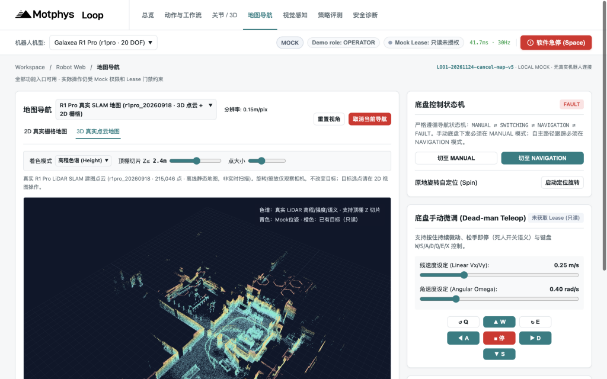
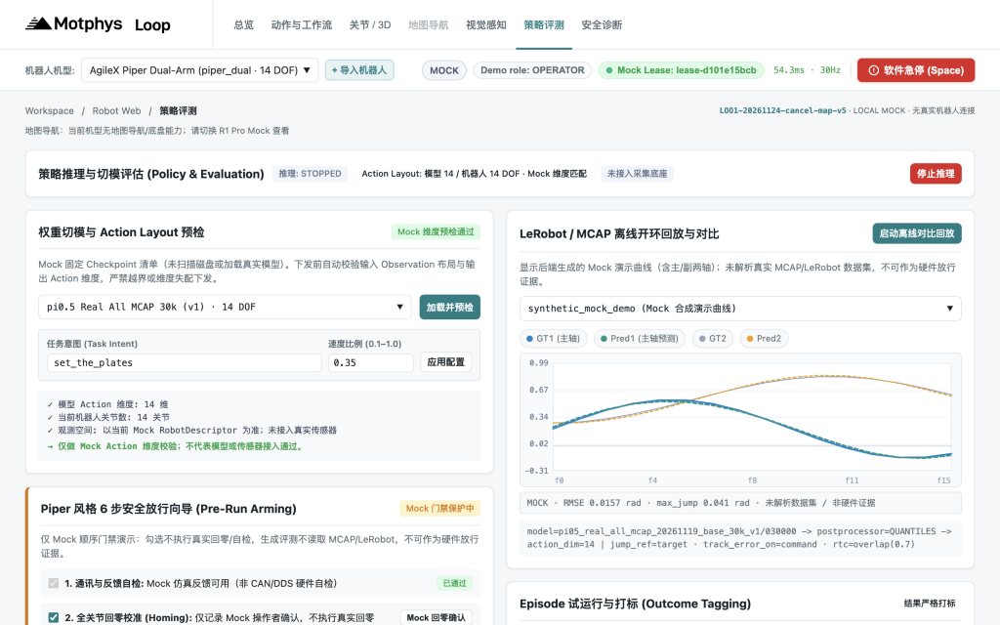
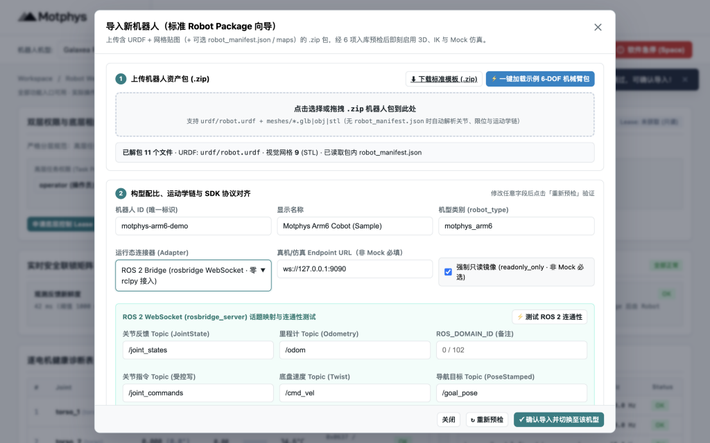

> **LOO-1 状态：仅本地 Mock 可运行；未接真实机器人/Edge 鉴权或 Lease。**
> 实际功能、验证与剩余事项以 [LOO-1 交付记录](docs/LOO-1.md) 为准，下面原始说明不构成真机验收证据。

# Motphys Robot Web — 机器人高层控制与感知统一平台（v1）

整合 **`r1pro_web`**（视觉感知 / 原子动作 / 工作流 / 导航 / 6D 末端）、**`dex_web`**（3D URDF / Motrix 只读仿真镜像 / 逐电机联锁诊断 / 安全心跳）、**`piper_lelab`**（动态切模 / 6 步安全向导 / 离线回放评测 / 打标）三套能力，严格遵守 [架构设计文档](docs/ARCHITECTURE.md) 与高层/底层分离红线，采用 **Motphys Loop** 设计变量与布局（非 1:1 框架移植）。

## 效果预览 (Screenshots)

### 1. 3D URDF 全息幽灵、6D IK 与多步分色工作流轨迹预演
支持真实 UV 贴图 URDF 渲染、仅点亮运动支链的全息幽灵、防遮挡 X-Ray 多步分色霓虹轨迹、3D 步骤交接路标与可点击分步时间轴（免 Lease 预演）：



### 2. 工作流闭环到位判定与单步断点调试（Pause / Step / Resume）
实时轮询关节/导航/视觉闭环收敛状态与超时熔断，支持逐步骤单步断点调试（`⏭ 下一步` / `▶ 继续全部` / 暂停即时 `safe_stop`）与参数传递上下文追踪：



### 3. 真实 2D/3D LiDAR SLAM 地图导航与底盘微调
内置高精 2D 栅格图与 3D 静态点云（支持高程/强度/语义着色与顶棚 Z 轴切片），联动 `MANUAL ⇄ NAVIGATION` 状态机与死人开关点动：



### 4. 策略切模、Action Layout 契约预检与 HiDPI 离线回放曲线
支持 VLA / `pi0.5` Checkpoint 切换、维度契约预检、Piper 6 步安全放行向导、Retina HiDPI 离线对比曲线与 Episode 打标：



### 5. 数据驱动「+ 导入机器人」标准资产包向导与 ROS 2 WebSocket 接入
支持上传标准 `.zip`（或纯 URDF 自动推导关节与运动学链），经 6 项入库预检后即刻启用 3D/IK；内置零 `rclpy` 依赖的 `rosbridge_server` WebSocket 协议桥接与一键连通探针：



## 快速启动

```bash
cd motrix_robot_web
uv sync --extra dev
./scripts/start.sh
# 默认打开 http://127.0.0.1:8096
```

自定义端口或加载自定义机器人配置：

```bash
uv run python -m motrix_robot_web --host 127.0.0.1 --port 8096 --config config/robots.example.yaml
```

## 运行测试

```bash
cd motrix_robot_web
uv run pytest -v
node --test tests/*.mjs
```

## 内置三构型 Mock & 自定义导入（开箱零硬件体验）

启动后可在顶栏机器人选择器中自由切换，或点击「`+ 导入机器人`」通过 6 项门禁向导导入任意 URDF 资产包 / ROS 2 WebSocket 桥；界面模块会根据 `capabilities` 自动适配：

1. **`R1 Pro (20-DOF 双臂+躯干+底盘)`**：完整开启全部 7 大能力域——真实 UV 贴图 URDF 3D 运动学与 6D FK/IK 全息轨迹预演、多步分色工作流预演与闭环单步断点调试、高精度 2D/3D SLAM 导航地图、4 路相机 + 头部在线深度 + `YOLO → 锁存分割 → FoundationPose` 三步门禁 + `ArUco` 微调、VLA 推理/MCAP 评估、逐电机诊断。
2. **`Piper Dual-Arm (14-DOF 双臂)`**：自动隐藏底盘导航；开启真实 URDF 14 维双臂 3D 与关节调整、6 步 LeLab 安全武装向导、动态 Checkpoint 切换、LeRobot v3 离线回放评测与曲线、Episode 打标与 Loop 对象链登记、唯一 CAN 写者安全提示。
3. **`Dexforce W1 (20-DOF 人形)`**：真实 GLB URDF + BrainCo Revo1 双灵巧手离线渲染、20s 高清实时关节示波器、Motrix 只读消息桥（WS `/ws/motrix`，尚未接入 WASM 仿真器）、逐电机温度/错误码联锁诊断与故障注入演练。

## 安全默认行为

- 启动即**硬只读**：未获取控制租约（Lease）前所有运动/写控接口返回 `403`。
- **双层权限分离**：高层任务权限（Viewer / Operator）与底层控制租约（Lease）在顶栏和诊断页分别展示。
- **3s 操作心跳 + 5min 闲置超时**：持租约期间页面每 1s 上报心跳；断联超 3s 自动解除控制并触发安全保持。
- **免租约全局急停**：顶栏红色 `E-Stop` 按钮与快捷键 `Shift+Space` 在任何状态下均可触发，走旁路立即中断执行并锁存（明确区分软件 `safe_stop` 与现场硬件断电急停）。
