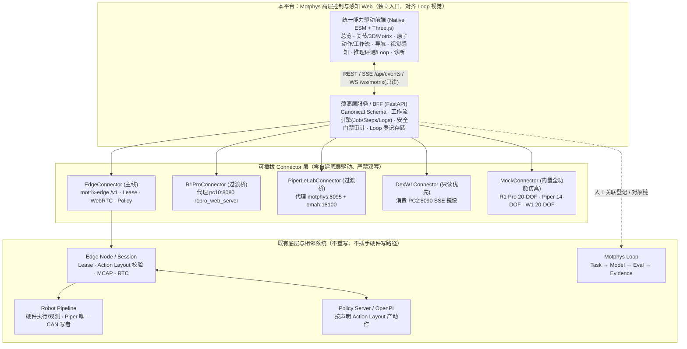

# Motphys Robot Control & Perception Web — 统一整合架构设计

> **版本**：v1.0（P0 边界锁定 + P1/P2/P3 完整可运行基线）  
> **定位**：独立的高层控制与感知 Web 平台（与 **Motphys Loop** 同属一套视觉与认证体系的平级姊妹产品；不从属 Edge Console，不重做底层控制底座）。  
> **整合来源**：
> 1. `r1pro_web`（Galaxea R1 Pro 高层视觉感知、原子动作、工作流编排、6D 末端 IK、Nav2 导航、VLA 评估）
> 2. `dex_web`（Dexforce W1 实时 3D URDF 姿态、Motrix WASM 只读仿真镜像、逐电机诊断与安全心跳体验）
> 3. `piper_lelab`（Piper 动态模型/Checkpoint 切换、6 步安全武装向导、LeRobot 数据集离线回放、动作溯源与打标、训练/GR-BC 证据关联）

---

## 1. 产品边界与架构红线（严格对齐路线图）

本平台与底层 **Motrix Edge**、上层评测/训练台 **Motphys Loop** 分层协作，不互相替代：

### 六条不可突破的架构红线
1. **不自建控制底座**：不自建版本化 Gateway、不自建 ControlArbiter、不重做底层运动学（MotrixSim FK/IK 归底层）、不自建 MCAP/RTC/远程连接底座。
2. **双层权限分离**：`高层任务权限（Task Permission）` ≠ `底层控制租约（Edge Lease）`。默认只读进入；必须同时具备高层权限 + 有效底层 Lease（或过渡桥 Token）才允许发送低速运动、工作流或推理意图。
3. **心跳与免租约急停**：受控会话维持 3s 操作心跳（断联或 5min 闲置自动解除控制并触发安全保持）；**全局急停（E-Stop）走旁路且免租约/免 Token**，任何状态可达；明确提示「软件 `safe_stop` ≠ 硬件断电急停」。
4. **3D 与 Motrix 仿真严格只读**：URDF 3D 视图、紫色目标幽灵预览、`/ws/motrix` 仿真桥只消费 `Observation Layout` 状态，绝不导入硬件驱动、绝不反向下发。
5. **唯一写者原则**：Piper 的唯一 CAN 写者归 `Robot Pipeline`；严禁 `motrix-edge` 与 `piper_lelab` 同时写同一 CAN 口；R1 Pro 过渡期保留 `webv2` 但严禁双入口并发写。
6. **区分事实与状态语义**：`mock / sim / real` 在顶栏强标识隔离；评测结果严格区分 `no_result（无结果）/ zero_success（零成功）/ unknown（未知）`。

---

## 2. 三合一能力整合矩阵

系统通过每台机器人声明的 `RobotDescriptor.capabilities` 自动装配前端导航与功能模块：

| 统一模块 | 吸收自哪套系统 | 核心能力 | R1 Pro (20-DOF) | Piper Dual (14-DOF) | Dexforce W1 (20-DOF) |
|---|---|---|---|---|---|
| **总览 (Overview)** | PDF + 三套 | 机器人切换、`MOCK/SIM/REAL` 标记、双层权限摘要、关键状态 KPI、最近 Jobs | ✅ | ✅ | ✅ |
| **关节与 3D (Joints & 3D)** | `dex_web` + `r1pro_web` | 3D 实时姿态 + 紫色目标幽灵预览、分组滑块、限位/NaN 校验、20s 实时曲线、保存选中为原子动作、末端 6D 点动、Motrix 只读镜像 | ✅ (含躯干4轴+双臂7轴+夹爪+6D) | ✅ (双臂6轴+夹爪+6D) | ✅ (真实W1 URDF+Motrix镜像) |
| **原子动作与工作流 (Actions)** | `r1pro_web` + `Motphys Loop` | 原子动作库 CRUD、可视化步骤工作流编排（延时/参数覆盖/模板生成）、Loop Actions 风格执行列表 + 右侧滑出 `Execution task` 抽屉（Steps + 暗色实时 Logs + Follow + Retry） | ✅ | ✅ | ✅ (只读或受限点动) |
| **导航与底盘 (Navigation)** | `r1pro_web` | 2D 占据栅格地图渲染（`mx_map.png`/`yaml`）、点击拖拽设 Goal Pose（x/y/yaw）、`MANUAL/SWITCHING/NAVIGATION/FAULT` 控制权状态机、按住式底盘死人开关、原地旋转定位 | ✅ | 🚫 自动隐藏 | ✅ (可选/默认只读) |
| **视觉感知 (Perception)** | `r1pro_web` | 4 路可自由选流相机槽、点击画面取 `base_link` 3D 坐标、头部在线深度开关、严格三步门禁（`YOLO → 锁存最佳分割 → FoundationPose 6D`）、ArUco 识别与底盘离散微调 | ✅ (全链路) | ✅ (3 路 RealSense 观测) | ✅ (头/腕只读相机) |
| **推理与 Loop 评测 (Policy & Loop)** | `piper_lelab` + `r1pro_web` + `Loop` | 动态 Checkpoint 扫描/切换与输入输出契约预检、Piper 6 步安全武装向导、推理任务意图下发、LeRobot/MCAP 离线开环回放评估曲线、Episode 打标、Loop 人工对象链登记 | ✅ (`r1pro.v2` OpenPI + MCAP 评估) | ✅ (动态切模 + LeRobot 回放 + 6 步向导) | 🚫 / 按需扩展 |
| **诊断与安全 (Diagnostics)** | `dex_web` + `r1pro_web` | 逐电机温度/力矩/状态字/错误码监控与联锁分级、故障注入演练（Mock）、双层权限与 3s 心跳看门狗、Connector 配置视图、Topics / Health / Raw State JSON 检视 | ✅ | ✅ | ✅ |

---

## 3. Canonical Data Model（对齐 Edge Observation / Action Layout）

为避免另造第四套协议，所有前端视图和工作流引擎均只消费一套标准高层模型（定义于 [schemas.py](../backend/motrix_robot_web/schemas.py)）：

1. **`RobotDescriptor`**：机器人元信息、`mode (mock|sim|real)`、`connector_type (mock|edge|r1pro|piper_lelab|dex_w1)`、`arms_scope`、`joint_layout`（名称、分组、上下限、单位、是否为夹爪）、`camera_streams`、`capabilities` 布尔矩阵、`network_note`（如 R1 `192.168.3.x` NAT 提示）。
2. **`ObservationSnapshot`**（对应 Edge `Observation Layout`）：`timestamp`、`feedback_age_ms`、`measured_hz`、`joint_positions`、`joint_velocities`、`joint_efforts`、`ee_poses`（`base_link` 6D）、`motors`（温度/错误码/使能/状态字）、`interlocks`、`battery`、`navigation_state`、`perception_state`、`policy_state`。
3. **`AuthorityState`**（双层权限显式拆分）：
   - 高层：`task_permission`（`viewer | operator | admin`）、`operator_name`
   - 底层：`lease_active`、`lease_id`、`lease_source`、`lease_ttl_s`、`heartbeat_age_s`、`hb_timeout_s (3.0)`、`idle_timeout_s (300.0)`、`estop_latched`、`teach_arms_only (True)`
4. **`AtomicAction` & `WorkflowDefinition` & `ExecutionJob`**（兼容 R1 Pro `actions.json`/`sequences.json` + 对齐 Loop Actions）：
   - `ExecutionJob` 包含：`job_id`、`run_id`、`flow_name`、`kind (Manual|Workflow|Eval|Inference)`、`state (Running|Succeeded|Failed|Canceled)`、`robot_id`、`created_at`、`started_at`、`finished_at`、`exit_code`、`pipeline_sha`、`steps: list[JobStep]`、`logs: list[str]`。
5. **`LoopRecord`（人工关联对象链）**：
   - `Task → TrainingRun | ExistingModel → ModelArtifact → EvaluationPlan → EvaluationResult + Evidence → NextAction`
   - 评测结果状态枚举强制拆分：`passed | failed | zero_success | no_result | unknown`。

---

## 4. Connector 契约与过渡演进策略

每个 Connector 实现统一抽象基类 [connectors/base.py](../backend/motrix_robot_web/connectors/base.py)：
- **只读观测**：`get_descriptor()`、`get_observation()`、`get_camera_frame(stream_key)`
- **受控租约**：`acquire_lease(operator, token)`、`release_lease()`、`heartbeat()`
- **受控动作（均须经 SafetyGate + Active Lease）**：`send_joint_targets(...)`、`send_ee_step(...)`、`send_chassis_velocity(...)`、`set_navigation_mode(...)`、`send_navigation_goal(...)`、`control_perception(...)`、`control_policy(...)`
- **免租约旁路**：`emergency_stop(source, reason)`

### 演进门禁（对齐 PDF P0–P3）
- **P0（已完成于本仓基线）**：锁定边界、三合一架构文档、Canonical Schema、双层权限与安全单测。
- **P1（只读反馈）**：零写控对接 `EdgeConnector` / `Ros2BridgeConnector` / `DexW1Connector` / `R1ProConnector` / `PiperLeLabConnector`，在统一网页里只读查看多机型关节、3D、相机、健康状态与离线回放。
- **P2（授权对接）**：待 Edge M2–M4 与安全门禁（全关节限位/NaN/3s 心跳/免租约急停/状态联锁）验收通过后，开启受控写路径；Piper 切至 Edge 唯一 CAN 写者并退役 LeLab 直写 CAN 环。
- **P3（Loop 关联）**：接通飞书登录 / Loop 对象链 API，取代本版 JSON 人工台账。

---

## 5. v1.2 已落地的核心增强能力（与当前代码库同步）

1. **三机型真实 URDF/贴图 + 6D FK/IK 与全息轨迹预演**：
   - R1 Pro（Galaxea 官方 UV 贴图 OBJ + `output.jpg`）、Piper Dual（77 视觉 STL/OBJ + D405 贴图）、Dexforce W1（21 GLB + 10 内嵌贴图 + BrainCo Revo1 双灵巧手）全部离线本地渲染。
   - 纯 Python 解析雅可比 6D DLS IK 与五次多项式规划器（[kinematics.py](../backend/motrix_robot_web/kinematics.py)），支持关节方向反转 `sign`、零点偏置 `zero_offset` 与 `urdf_scale`；前端只点亮运动支链的全息轮廓幽灵 + 防遮挡 X-Ray 霓虹轨迹带 + 方向箭头 + 地面深度投影 + `🎯 聚焦轨迹` + `0.5×/1×/2×` 慢放。
   - 工作流引擎（[workflow_engine.py](../backend/motrix_robot_web/workflow_engine.py)）支持 `action_produces / action_requires` 上下游参数传递（`workflow_xyz / workflow_pose / aruco_pose`）、多步分色 3D 轨迹预演与步骤交接路标、统一预演与 Live 下发、在线 IK 残差复核、真实闭环到位判定与超时熔断，以及 `Paused` 暂停 / 继续 / 单步断点调试。
2. **高精度真实 2D/3D 导航地图**：
   - R1 Pro 默认加载 Fast-SLAM Plus 高精 2D 栅格图（`bag_20260914_map.png`, `0.05m/pix`）与对齐的 98.1 万点 3D 静态点云（`virtual_machine_map.pcd`），并支持切换 `mx_map` 与 `r1pro_20260918` 对照图，诚实标注 `live: false`。
3. **全数据驱动「+ 导入机器人」标准资产包向导**：
   - [robot_importer.py](../backend/motrix_robot_web/robot_importer.py) 支持上传 `.zip`（无 `robot_manifest.json` 时自动从 URDF 推断关节、限位与运动学链），内置 Zip-Slip/符号链接/后缀白名单拦截、6 项入库预检门禁、`/custom-robots` 仅挂载已发布的 `packages/`（隔离 `registry.json` 与自动清理的 `_staging/`）以及重启持久化。
4. **零 `rclpy` 依赖的 `Ros2BridgeConnector`**：
   - [ros2_bridge.py](../backend/motrix_robot_web/connectors/ros2_bridge.py) 通过标准 `rosbridge_server` WebSocket 协议跨网段订阅 `/joint_states`、`/odom`、`/battery_state`（容错 JSON `null/NaN`，新鲜度阈值与 SafetyGate 统一为 `1000ms`，默认强制 `readonly_only=True`），并在 `POST /api/robots/ros2/probe` 内置 SSRF 防护（仅允许本机/RFC1918 私网/`*.local` 或显式白名单）。
5. **Motphys Loop 高清实时示波器**：
   - 20s 实时关节曲线重构为 Retina HiDPI 浅色工程示波器，支持跟踪误差带、软限位警戒线、悬停十字准线浮层、暂停/清空与右侧五次多项式 `S-Curve` 预演叠加。
